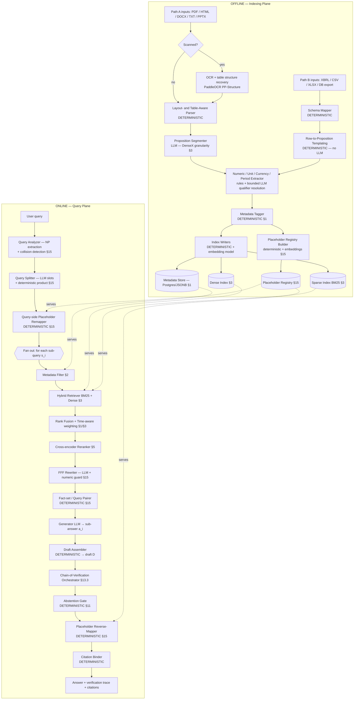

# Enhancing Financial RAG with Noun-Phrase Collision Elimination and Chain-of-Verification
## A Faithfulness-First Approach to Hallucination Reduction in Enterprise Settings
### System Architecture Blueprint — Revision 2 (implementation-ready)

**Status of this document.** This is the authoritative build specification. It is written to be executed by an AI coding agent, which means every component carries an explicit **engine** (deterministic code vs. LLM vs. neural non-generative model), a **typed interface**, and **acceptance tests**. Where a component is deterministic, that is a *requirement*, not a preference — an implementer must not substitute an LLM call.

**Provenance convention.** §N references point to sections of the source survey compilation (Gao et al. 2312.10997; Alansari & Luqman 2510.06265; Sahoo et al. 2402.07927; Ding et al. 2402.10612; Wood & Forbes 2412.05223). Anything named that the source papers do not prescribe is tagged **[implementation choice]** and is swappable behind its interface.

---

## 1. Design Thesis and Governing Principles

### 1.1 Objective

The system optimises for **faithfulness**, not correctness (§15.1). Faithfulness means the response introduces no information absent from the retrieved, cited evidence. This is chosen because it is concretely measurable, and because in an audited enterprise finance setting an answer that cannot be traced to a source filing is unusable regardless of whether it happens to be true.

### 1.2 The domain problem

Financial corpora concentrate the exact failure mode Acurai targets — **noun-phrase collisions** (§15), where two distinct-but-embedding-similar entities are merged by the model. In finance these collisions run along three axes:

- **Metric axis** — gross / operating / net margin; revenue / net revenue; GAAP / non-GAAP; basic / diluted EPS.
- **Temporal axis** — Q3 FY23 vs Q3 FY24; trailing-twelve-month vs fiscal-year.
- **Entity axis** — parent vs subsidiary; similarly named funds, tickers, issuers.

### 1.3 The two structural guarantees

- **Input-side guarantee (§15).** The Acurai chain — collision detection → query splitting → Fully-Formatted Facts → fact-set/query pairing → placeholder remapping — ensures that **no two colliding entities ever reach the model inside a single prompt**.
- **Output-side guarantee (§13.3).** Chain-of-Verification re-answers every atomic claim *independently of the draft* against the cited evidence, and drops or flags whatever fails.

### 1.4 Governing principle: constrained LLM surface

> **An LLM is used only where linguistic generation or semantic judgment is genuinely required. Every numeric, structural, and provenance operation is deterministic code.**

This is the load-bearing design decision of the whole system. If an LLM can touch a digit, invent a citation, or decide whether two numbers are equal, the faithfulness guarantee is only as strong as the model's sampling that day. The LLM appears at **six points only** (§4 and §6, summarised in §11). Everything else is Python.

### 1.5 Governing principle: provenance tiers

Every fact carries a provenance tier. This exists so that future extensions (calculation, web search — §13) do not force a redefinition of the core metric.

| Tier | Meaning | Faithfulness criterion |
|---|---|---|
| `retrieved` | Verbatim from the indexed corpus | Must match source proposition exactly |
| `derived` | Computed from retrieved facts | Every input traceable to `retrieved` facts **and** operation reproducible |
| `external` | From outside the corpus (future: web) | Lower trust; must be cited and tier-labelled in output |

At Revision 2 only `retrieved` is produced. `derived` and `external` are schema-reserved and interface-supported.

---

## 2. Macro-Architecture

Two planes — an **offline indexing plane** (runs on corpus change) and an **online query plane** (runs per question) — sharing three indexes and one registry. The offline plane has **two ingestion paths** converging on one proposition store.



### 2.1 The three-index invariant

The dense index, sparse index, and metadata store index **the same atomic units** (propositions), keyed by an identical `proposition_id`. This is a hard invariant: hybrid retrieval only works if both arms score the same objects, and citation binding only works if every retrievable unit carries its own provenance. No component may violate it.

---

## 3. Engine Assignment Table (authoritative)

`DET` = deterministic code, no model. `EMB` = embedding/neural non-generative model. `LLM` = generative model call. An implementer **must not** promote a `DET` component to `LLM`.

| # | Component | Engine | Non-negotiable constraint |
|---|---|---|---|
| 4.1 | OCR Tier | EMB (OCR model) | Emits `ocr_confidence`; never invents characters |
| 4.2 | Layout/Table Parser | DET | Format-driven, content-agnostic |
| 4.3 | Schema Mapper (Path B) | DET | — |
| 4.4 | Row-to-Proposition Templating | DET | No LLM on structured input |
| 4.5 | Proposition Segmenter | LLM | Structured output; may not alter digits |
| 4.6 | Numeric/Unit/Period Extractor | DET + bounded LLM | **LLM resolves qualifiers only; digits copied verbatim by code** |
| 4.7 | Metadata Tagger | DET | From filing headers / XBRL tags |
| 4.8 | Placeholder Registry Builder | DET + EMB | Reference data; no generation |
| 4.9 | Index Writers | DET + EMB | Enforces three-index invariant |
| 6.1 | Query Analyzer | DET + EMB | Lexicon-only. **No LLM fallback** — see §6.1 |
| 6.2 | Query Splitter | LLM (slots) + DET (product) | Split itself is a Cartesian product in code |
| 6.3 | Query-side Placeholder Remapper | DET | Dictionary substitution |
| 6.4 | Metadata Filter | DET | SQL over Postgres |
| 6.5 | Hybrid Retriever | DET + EMB | — |
| 6.6 | Rank Fusion + Time weighting | DET | — |
| 6.7 | Cross-encoder Reranker | EMB | Cross-encoder is **not** a generative LLM |
| 6.8 | FFF Rewriter | LLM + DET validator | **Numeric-verbatim guard mandatory** |
| 6.9 | Fact-set/Query Pairer | DET | Keyed binding only |
| 6.10 | Generator | LLM | Answers from paired FFFs only |
| 6.11 | Draft Assembler | DET | Templating; introduces no facts |
| 6.12.2 | Plan verification questions | LLM (extract) + DET (template) | — |
| 6.12.3 | Execute independently | LLM | **Draft excluded from context** |
| 6.12.4 | Revise — numeric claims | **DET** | **Never an LLM equality judgment** |
| 6.12.4 | Revise — prose claims | LLM | — |
| 6.13 | Abstention Gate | DET | Rules over verification results |
| 6.14 | Placeholder Reverse-Mapper | DET | — |
| 6.15 | Citation Binder | DET | **An LLM never writes a citation** |

---

## 4. Offline Indexing Plane

### 4.1 OCR Tier (conditional, Path A only)
- **Engine:** OCR model. **[implementation choice]** PaddleOCR with **PP-Structure**, chosen because it performs layout analysis and **table structure recognition**, not merely line-level text OCR. Plain OCR on a scanned 10-K yields numbers with no row/column association, which is useless for financial extraction. Alternatives behind the same interface: docTR, Surya, commercial extractors.
- **Trigger:** invoked only when a PDF has no extractable text layer.
- **Mandatory output field:** `ocr_confidence` per proposition. OCR-derived figures are the **lowest-confidence input in the system** — a misread decimal is a material misstatement — and the Abstention Gate (§6.13) treats them more conservatively.

### 4.2 Layout- & Table-Aware Parser
- **Engine:** DET. **No LLM.**
- **Behaviour on ordinary prose:** works normally. Parsing is driven by **file format, not content**. Plain text passes straight through; table logic simply never fires when there are no tables. A document containing no financial records is handled correctly and produces ordinary prose propositions.
- **Formats:** PDF, HTML, DOCX, TXT, PPTX. XBRL, CSV, XLSX are routed to Path B instead.
- **Output:** normalised text with reconstructed tables (row/column headers retained) and section boundaries.

### 4.3 Schema Mapper (Path B)
- **Engine:** DET. Maps incoming columns/tags to the canonical fields of §5.1 (`company`, `metric`, `period`, `value`, `unit`, `scale`, `currency`).

### 4.4 Row-to-Proposition Templating (Path B)
- **Engine:** DET. **No LLM.**
- **Rationale:** a CSV row, an XLSX cell with headers, or an XBRL tagged fact **is already a proposition**. Passing it through an LLM segmenter is wasteful, lossy, and introduces a hallucination surface for zero benefit.
- **Behaviour:** row + column header + sheet/context → templated sentence, e.g. `"<ENT_1> operating margin for Q3 FY2024 was 18.2 percent"`, produced by string templating.
- **Consequence worth stating in the seminar:** the system degrades gracefully from deterministic to inferential according to source fidelity, rather than treating all inputs as equally uncertain. Path B is strictly more trustworthy than Path A and will carry most of the numeric load in enterprise finance.

### 4.5 Proposition Segmenter (Path A) — *Proposition retrieval / DenseX, §3*
- **Engine:** LLM, structured output (schema §7.2).
- **Purpose:** split parsed prose into **atomic, self-contained factual statements** rather than fixed-size chunks. Proposition granularity is chosen over fixed-size or sliding-window chunking (§1) because it minimises cross-entity content per retrievable unit — the same principle Acurai enforces downstream, applied here at index time.
- **Relationship to FFFs, stated precisely:** DenseX (§3) supplies the *index-time retrieval unit*; Fully-Formatted Facts (§15, applied online at §6.8) supply the *query-time rewrite*. They are complementary. Propositions make the FFF rewrite cheaper and cleaner but do **not** replace it.
- **Constraint:** may not alter any numeric token present in the source span.

**Pilot notes, decided 2026-07-24.** Model: `gpt-4.1-mini-2025-04-14` (pinned snapshot, not the floating `gpt-4.1-mini` alias). Rationale: segmentation is mechanical instruction-following, not reasoning — a reasoning-capable model (e.g. GPT-5 mini) bills hidden reasoning tokens as output, and output is ~75% of this workload's cost, so reasoning tokens there are pure cost and latency with no quality benefit for this task. GPT-4.1 mini has no reasoning step and is ~20% cheaper on output. Consequently:
- `include_reasoning_field: false` for this call site only (config/schema.py, `llm/schemas.py:PropositionSegmenterOutputNoReasoning`) — a deliberate, documented exception to §7.1 rule 3's default ("reasoning field first"), scoped to this one call site.
- **Rate-limit constraint (hard blocker).** `gpt-4.1-mini` at OpenAI Tier 1 caps at 10,000 requests/day, 500 RPM, 200,000 TPM. One call per PDF page across 84 documents is ~12,600 calls — over the daily cap. Two mitigations, together bringing this to ~4,000 calls:
  1. **Page batching** — two pages per LLM call (`offline/propositions/segmenter_llm.py:segment_pages`), halving request count and repeated system-prompt overhead. Page attribution is never trusted from the model: each returned proposition is assigned to whichever page in its batch has the highest token overlap with its text, deterministically (CLAUDE.md §2 — provenance is code, not model output).
  2. **Content-based page filter** (`offline/parsers/page_filter.py`) — skips cover pages, tables of contents, signature blocks, exhibit indices, and SEC certifications before they reach the segmenter. Content-based only, classifying each page from its own text; it must never consult which pages carry FinanceBench gold evidence, or the indexing pipeline would leak evaluation data into itself.
- Concurrency 16 per call site (`config/schema.py:CallSiteLLMConfig.concurrency`), enforced against OpenAI's rate limits by a thread-safe sliding-window limiter (`llm/rate_limiter.py`) that blocks with backoff rather than dropping or reordering a call.
- Prompt caching: OpenAI caches automatically on a shared prefix (no explicit cache-control API in Chat Completions, unlike Anthropic) — the segmenter's system prompt is a fixed constant reused unmodified across every batch call, so it qualifies without any special handling.
- Pricing (verified against OpenAI's pricing page 2026-07-24): $0.40 / 1M input tokens, $0.10 / 1M cached input tokens, $1.60 / 1M output tokens.
- **Pilot-then-approve process.** A 3-document pilot is run and reported (actual tokens, cost, elapsed time, pages skipped by the filter, requests used, extrapolated to 84) before any full 84-document run — `offline/pilot.py:run_pilot` takes an explicit document list and never expands it itself, and enforces a hard spend cap (checked after every LLM call, not just at the end) plus per-document checkpointing so a mid-run failure resumes rather than re-billing completed documents.

**Provider and model switchability — first-class, decided 2026-07-24.** Every one of §11's six call sites independently specifies provider, model, temperature, seed, and concurrency in config (`config/schema.py:CallSiteLLMConfig`) — a YAML edit, never a code change. `LLMClient` (`llm/client.py`) remains the only seam (`tests/test_no_direct_sdk_imports.py` still enforces this — `llm/adapters/` is exempted, nothing outside `llm/` may import a provider SDK). `llm/adapters/{openai,anthropic,ollama}_adapter.py` each normalize their provider's structured-output mechanism (OpenAI `response_format`, Anthropic forced tool-use, Ollama `format`) behind one `ProviderAdapter.complete` method; `llm/routing.py:build_llm_client` constructs a `RoutedLLMClient` per call site from config. What doesn't carry across providers is reported explicitly rather than papered over:
- `seed_supported`: hosted APIs (OpenAI, Anthropic) accept or ignore a seed but never guarantee determinism from it — always `False`. Only Ollama (local, fixed weights/quantization/hardware) can honestly report `True`.
- Reasoning tokens billed as output are reported separately (`AdapterResponse.reasoning_tokens`) so cost accounting isn't silently wrong for models that have a reasoning step.
- RPM/TPM/RPD are per-provider config (`config/schema.py:ProviderConnectionConfig`), not hardcoded in an adapter.
- The run manifest (§10.4) records provider, model, temperature, seed, and adapter version **per call site** (`llm/routing.py:LLMCallSiteManifest`), not one global entry — a run using two providers at once must be fully reconstructable from its manifest alone.
- `tests/test_provider_swap.py` asserts the abstraction actually holds: the same call site, run through two different adapters, returns objects conforming to the same schema.
- `qwen2.5:7b-instruct-q4_K_M` via the Ollama adapter (benchmarked at 29.8 tok/s with full GPU offload) stays available as an on-prem fallback and a reportable comparison point for §1.1's deployment argument, independent of the OpenAI/Anthropic path.

### 4.6 Numeric / Unit / Currency / Period Extractor
The most safety-critical offline component. **Three tiers, in priority order:**

1. **XBRL tagged facts** → read `value` / `period` / `unit` directly. Lossless, zero inference.
2. **Rules/regex** over parsed text → handles the large majority of narrative figures.
3. **Bounded LLM** → resolves *ambiguous qualifiers only* ("the quarter" → which fiscal quarter; "the prior period" → which period).

> **Hard rule:** the LLM **classifies and resolves; it never re-emits a number**. Digits are copied verbatim from source by code. Any LLM output containing a digit not present in the source span is rejected.

- **Output:** structured numeric record (§5.1). This structured shadow is what makes CoVe's numeric verification deterministic rather than string-matched.

### 4.7 Metadata Tagger — *Metadata attachment, §1*
- **Engine:** DET. Fields drawn from filing headers, XBRL contexts, and file provenance. Schema §5.1.

### 4.8 Placeholder Registry Builder — *Placeholder remapping, §15*
- **Engine:** DET + EMB (similarity clustering to find collision candidates). No generation.
- **Domain scope:** tickers, CUSIP/ISIN/CIK, filing accession numbers, and entity names colliding across senses (company name that is also a common word; parent vs subsidiary sharing a stem).
- Uses the one shared `Embedder` (§4.9, `offline/embedding/bge_embedder.py`) — never a second instantiation. Calls `encode_passages` only: surface forms are corpus-side reference data compared to each other, not a query.

### 4.9 Index Writers
- **Engine:** DET + embedding model.
- Writes vectors → Dense Index, postings → Sparse Index (BM25), structured fields → Metadata Store, all keyed by shared `proposition_id` (§2.1).
- **[implementation choice], decided 2026-07-24: `BAAI/bge-base-en-v1.5` via `sentence-transformers`, pinned by exact revision hash** (not just model name — HuggingFace checkpoints can be updated in place at a fixed name). Chosen because: results must be reproducible from the run manifest (§10.4) and an API embedder can be silently revised or deprecated out from under a run; the thesis argues for on-prem enterprise deployment (§1.1), so sending confidential filings to a third-party embedding API undercuts that before the system even reaches the LLM; and it pairs with the already-specified `bge-reranker` (§6.7) — same lab, same training recipe family.
  - **One shared embedder component**, used by both this module and the Placeholder Registry Builder (§4.8) — not two instantiations. The three-index invariant (§2.1) requires the dense index to be built by exactly one embedding path.
  - `model_name`, `revision`, and `dimension` (768 for bge-base-en-v1.5) are recorded in the run manifest (§10.4) on every run.
  - BGE's asymmetric query prefix (`"Represent this sentence for searching relevant passages: "`, queries only, never passages) is encoded structurally: the `Embedder` interface (§10.2/contracts/interfaces.py) exposes `encode_queries` and `encode_passages` as two separate methods rather than one `encode(text, is_query)`, so no call site can forget the prefix by omission.
  - `DenseIndex` asserts dimension consistency at write time and refuses (raises) to write a vector of the wrong length — never silently writes a corrupt index.
  - Dense/Sparse/Metadata backends themselves (FAISS-or-equivalent, BM25, PostgreSQL/JSONB) remain separately swappable **[implementation choice]**; the Phase 1 checkpoint uses in-memory equivalents sized for FinanceBench's 84-document corpus (§8A.1) — see `offline/indexing/index_writers.py`.

---

## 5. Persistent Stores and Schemas

### 5.0 Store selection
**Metadata Store: PostgreSQL with JSONB.** Chosen because the metadata filter (§6.4) is fundamentally relational — `company = X AND fiscal_year = 2024 AND quarter IN (3,4)` is a SQL query with a B-tree index behind it — and because transactional integrity across the three indexes is free. JSONB holds the nested `numeric` and `metadata` objects without a rigid column schema. **[implementation choice]**; MongoDB or vector-DB payload filtering are viable substitutes. The only invariant is §2.1.

### 5.1 Proposition record
```json
{
  "proposition_id": "string — stable, shared across all three indexes",
  "text": "atomic self-contained statement",
  "provenance_tier": "retrieved | derived | external",
  "ingestion_path": "A_unstructured | B_structured",
  "numeric": {
    "value": 18.2,
    "scale": "unit | thousands | millions | billions",
    "currency": "USD | null",
    "unit": "percent | ratio | absolute | count",
    "period": { "fiscal_year": 2024, "quarter": 3, "basis": "reported | ttm | restated" }
  },
  "confidence": {
    "ocr_confidence": 0.0,
    "extraction_tier": "xbrl | rules | llm_qualifier"
  },
  "metadata": {
    "company": "string",
    "ticker": "string",
    "filing_type": "10-K | 10-Q | 8-K | transcript | annual_report | csv | xlsx",
    "filing_date": "YYYY-MM-DD",
    "section": "string",
    "page": 34,
    "source_uri": "string"
  }
}
```
**This schema is a frozen contract.** CoVe's deterministic numeric comparison (§6.12.4) depends on it. Changing `numeric` breaks verification.

### 5.2 Fully-Formatted Fact — structured record and rendered line
FFFs are produced as **structured records** and rendered deterministically to text. This makes the numeric guard trivially checkable and citation binding exact.
```json
{
  "fff_id": "string",
  "proposition_id": "string — the source",
  "subject": "<ENT_1>",
  "metric": "operating margin",
  "period_label": "Q3 FY2024",
  "value_text": "18.2 percent",
  "provenance_tier": "retrieved",
  "source_ref": { "filing_type": "10-Q", "filing_date": "2024-11-05", "page": 34 }
}
```
Rendered line (the §15 one-fact-per-line form, subject noun restated explicitly):
```
<ENT_1> operating margin for Q3 FY2024 was 18.2 percent [src: 10-Q filed 2024-11-05, p.34].
```

### 5.3 Placeholder Registry entry
```json
{ "surface_form": "Acme Corp", "placeholder": "<ENT_1>",
  "canonical": { "ticker": "ACME", "cik": "0000000000" } }
```

### 5.4 Request context (per-request state)
The placeholder substitution map is **per-request state threaded from §6.3 to §6.14**. It must travel in this object, never a global.
```json
{ "request_id": "string", "config_hash": "string",
  "placeholder_map": { "<ENT_1>": "Acme Corp" },
  "sub_queries": [], "fff_sets": {}, "verification_trace": [], "collision_tags": [] }
```

---

## 6. Online Query Plane

### 6.1 Query Analyzer — *Noun-phrase collision detection, §15*
- **Engine:** DET + EMB. **No LLM fallback.** An earlier revision of this document
  described one; that contradicted §11, which caps the system at six LLM call sites and
  does not include this component. §11 governs. Queries the lexicon cannot parse return
  empty collision metadata and proceed.
- **Method:** extract noun phrases; score pairwise similarity; flag pairs that are
  **semantically similar but referentially distinct** — distinguishable by metric name,
  period, or entity id. A domain lexicon covers the three collision axes (§1.2)
  deterministically.
- **Output:** detected collision pairs, tagged by axis (`temporal` / `entity` / `metric`).

> **Scope, stated precisely.** This component detects collisions; it does **not** drive
> splitting. Slot parsing is Call Site 3 inside the Query Splitter (§6.2), and the split
> is a Cartesian product over those slots. A lexicon miss therefore degrades *diagnostic
> labelling*, never *decomposition correctness* — the split still happens whenever slot
> cardinality exceeds one. Collision metadata exists so results can be reported per axis
> against FinanceBench-Collision (§8A.2).

### 6.2 Query Splitter — *Query splitting, §15*
- **Engine:** LLM for **slot parsing only**; the split itself is a **Cartesian product in Python**.
- **Rationale:** asking an LLM to "split this query" is unreliable and unprovable. Deriving `{2 metrics} × {2 periods} = 4` sub-queries in code makes the completeness of the split **provable**.

  **Splitting is driven by slot cardinality, not by collision detection.** Any query whose
  slots yield more than one combination is split, whether or not §6.1 flagged a collision.
  This is deliberate: it removes lexicon coverage from the critical path, so an incomplete
  lexicon cannot silently disable NPCE.
- **Guarantee:** each emitted sub-query concerns exactly **one entity, one metric, one period**. No collision pair co-occurs in any sub-query.

### 6.3 Query-side Placeholder Remapper — *§15*
- **Engine:** DET. Substitutes registry placeholders into sub-queries; records the map in the request context (§5.4).

### 6.4 Metadata Filter — *Metadata Router/Filter, §2*
- **Engine:** DET (SQL). Converts sub-query slots into a hard filter on company, fiscal period, and filing type. Prevents retrieving the right metric from the wrong period or issuer — the most common financial retrieval error.

### 6.5 Hybrid Retriever — *Hybrid/Mix retrieval, §3*
- **Engine:** DET + EMB. **BM25 arm** for exact ticker / line-item / identifier match; **dense arm** for semantic recall. Run over the filtered candidate set.

### 6.6 Rank Fusion + Time-aware weighting — *§3 / §1*
- **Engine:** DET. **[implementation choice]** Reciprocal Rank Fusion. Then time-aware weighting (§1) so period-relative or "latest" sub-queries prefer recent propositions.

### 6.7 Cross-encoder Reranker — *Reranking (model-based), §5*
- **Engine:** EMB — a cross-encoder, **not** a generative LLM.
- **Purpose:** precision pass over fused top-K; bi-encoder retrieval alone is too coarse for near-identical financial line items.
- **[implementation choice]** `bge-reranker` or Cohere rerank (both named in §5). Open reranker is the default for on-prem enterprise.

### 6.8 FFF Rewriter — *Fully-Formatted Facts, §15*
- **Engine:** LLM (structured output, §5.2) **+ mandatory deterministic validator**.
- **Purpose:** rewrite reranked propositions into FFFs — one atomic fact per record, subject noun restated explicitly, exactly one entity/metric/period each.
- **Numeric-verbatim guard (mandatory):** every numeric token in a generated FFF must appear **verbatim** in its source proposition. On failure: reject, retry with bounded attempts, then drop the fact. Without this guard the rewriter is a silent hallucination vector upstream of everything else.
- **Coupling note:** source propositions must remain available at rewrite time; they may not be discarded after retrieval.

### 6.9 Fact-set / Query Pairer — *Fact-set/query pairing, §15*
- **Engine:** DET. Binds `FFF_i` strictly to `s_i`. Cross-entity information is never mixed in-context: only entity-A facts accompany an entity-A sub-query.

### 6.10 Generator — *generation stage*
- **Engine:** LLM, structured output.
- Answers each `s_i` from its paired `FFF_i` **only**. Because the input is single-entity, atomic, and placeholder-substituted, there is no collision surface to hallucinate across.
- **[implementation choice]** One instruction-tuned LLM serves segmentation, slot parsing, FFF rewriting, generation and verification as **distinct prompts, not distinct models**, unless evaluation motivates specialisation.

### 6.11 Draft Assembler
- **Engine:** DET.
- Combines `{a_1..a_n}` into draft `D` by templating (a margin comparison assembles into a table). **Introduces no facts.** An LLM is not used here: needing CoVe to catch assembler-introduced errors is worse than not introducing them.

### 6.12 Chain-of-Verification Orchestrator — *CoVe, §13.3*

**Step 1 — Draft.** Take `D` from §6.11.

**Step 2 — Plan verification questions.** LLM extracts every atomic claim (figure, period, entity attribution); question generation uses a deterministic template. One question per claim.

**Step 3 — Execute independently.** LLM answers each verification question **against the paired FFF evidence only, with `D` excluded from context**. Independence is what makes this verification rather than paraphrase. The orchestrator must construct these prompts without the draft — this is an enforced structural property, not a prompt instruction. Concretely, the function performing this step accepts no `draft` argument — independence is guaranteed by the function signature, not just by an omitted payload field, so a future change cannot reintroduce the draft "for context" without visibly changing that signature and failing `test_cove_independence`. See PROMPT_SPECIFICATIONS.md Call Site 6b.

**Step 4 — Revise.**
- **Numeric claims → DET.** Compare structured records (`value`, `unit`, `scale`, `period`) from §5.1 by code. **Never ask an LLM whether 18.2% equals 18.2%.** Delegating a deterministic equality check to a model reintroduces exactly the unreliability the system exists to remove. `unit`/`scale`/`period` are compared canonicalized, not as raw strings, since claim extraction and independent verification are independent LLM calls that can render the same period/unit differently (PROMPT_SPECIFICATIONS.md's Step 4 section documents the 2026-07-26 real-run finding and the exact normalization; it does not weaken detection of a genuinely different period — that remains the `fbc_metric_pri_0061` temporal-collision catch, §8A.7).
- **Prose claims → LLM.** Semantic comparison for non-numeric assertions.
- Matching claims kept; conflicting or unsupported claims dropped or flagged. Emits revised answer `V` + per-claim verification trace.

### 6.13 Abstention Gate — *Negative rejection, §11; CoN-style "unknown", §12.5*
- **Engine:** DET, rules over verification results.
- If a **material** claim fails verification, return "not supported by the available filings" for that claim, or abstain from the whole answer if the claim is central. Low `ocr_confidence` figures are treated more conservatively. No guessing.

### 6.14 Placeholder Reverse-Mapper — *§15*
- **Engine:** DET. Restores real names/identifiers from the request-context map.

### 6.15 Citation Binder
- **Engine:** DET, **always**.
- Attaches source (filing type, date, page, `source_uri`) by looking up the `proposition_id`s that survived verification. **An LLM never writes a citation** — that is precisely how fabricated sources appear in RAG systems.
- Emits final answer + citation set + verification trace + provenance tier per fact.

---

## 7. Structured LLM I/O (applies to all six LLM call sites)

Your instinct here is correct and it is now a system-wide requirement.

### 7.1 Rules
1. **Structured input.** Every LLM call receives a typed JSON payload, never concatenated prose. Evidence arrives as FFF records (§5.2), not a flattened blob.
2. **Structured output.** Every LLM call declares a JSON schema and is validated against it. Validation failure → bounded retry → deterministic fallback (drop the item, never invent one).
3. **Determinism.** `temperature = 0`, fixed seed where the provider supports it, pinned model version. Recorded in the run manifest (§10.4).
4. **Schema versioning.** Every schema carries a `schema_version`. The agent must not silently alter a schema.

### 7.2 One caveat, and it matters
**Do not over-constrain reasoning.** Strict constrained decoding can degrade reasoning quality if the model is forced straight into a terse answer field. The fix: include an explicit free-text `reasoning` field **before** the answer field in the schema, so the model reasons inside the structure rather than being denied room to reason. The `reasoning` field is logged for the audit trace and **never** parsed for facts.

### 7.3 Example — verification call (§6.12.3)
```json
// INPUT
{ "schema_version": "1.0", "verification_question": "What was <ENT_1> operating margin for Q3 FY2024?",
  "evidence": [ { "fff_id": "f_001", "subject": "<ENT_1>", "metric": "operating margin",
                  "period_label": "Q3 FY2024", "value_text": "18.2 percent" } ] }

// OUTPUT SCHEMA
{ "reasoning": "string — free text, logged, never parsed for facts",
  "supported": true,
  "answer_value": "18.2",
  "answer_unit": "percent",
  "supporting_fff_ids": ["f_001"] }
```
Note the draft `D` is absent from this payload by construction (§6.12.3).

---

## 8. Modularity — accurate characterisation

### 8.1 What is true
Every component has a typed interface (§10.2) and can be fine-tuned or swapped without disturbing its neighbours. The three-index invariant (§2.1) means retrieval internals can change freely behind `Retriever`.

### 8.2 What to claim, precisely
This is **"a Modular RAG implementation whose module interfaces admit adaptive routing, evaluated here in a fixed-pipeline configuration."**

Per §0 and §8, Modular RAG means swappable modules **plus** iterative/adaptive flow. This system has the swappable-modules half fully. It does **not** have the adaptive half: there is no Routing Module (§8), no iterative retrieval (§7), no memory module. Every query follows one fixed path. That is the correct scope — a fixed path is what a clean ablation *requires* — but claiming full Modular RAG in the paper's sense would overstate it, and a reviewer will notice.

**The system is not multi-routed.** It is single-path with pluggable modules. What is true and worth saying: the interfaces permit a router to be inserted ahead of the retrieval core later without disturbing components on either side.

### 8.3 Three real couplings (documented, not hidden)
1. **CoVe numeric comparison ↔ numeric schema (§5.1).** Swapping the extractor for one with a different structured record breaks verification. Mitigation: §5.1 is a frozen contract.
2. **Placeholder map is per-request state** (§5.4), threaded §6.3 → §6.14. Must not be a global.
3. **FFF numeric guard ↔ proposition availability.** Source propositions must survive until rewrite time.

---

## 8A. Dataset Specification

### 8A.1 Corpus: FinanceBench (Islam et al., arXiv:2311.11944)

**Selection rationale.** FinanceBench supplies gold evidence strings with document and page references, which is what makes faithfulness measurable against ground truth rather than LLM judgment alone. It also publishes a baseline (GPT-4-Turbo with retrieval fails 81% of questions) that anchors C0/C1 against an external reference, and its stated conclusion — hallucination limits enterprise suitability — is the problem this thesis addresses.

**Verified profile of the open-source release (150 questions):**

| Property | Value |
|---|---|
| Questions | 150 (50 metrics-generated / 50 domain-relevant / 50 novel-generated) |
| Companies | 32 |
| Documents referenced by questions | 84 (of 362 in the repo) |
| Pure "Information extraction" questions | **31** |
| Questions involving numerical reasoning | 57 |
| `question_reasoning = null` (novel-generated) | 50 |
| Corpus format | PDF only (digital-native SEC filings) |

**Ingestion consequences.** All FinanceBench input is PDF → **Path A only**. Path B (§4.3–4.4) has no input from this corpus and the OCR tier (§4.1) will not fire, since SEC filings 2015–2024 are digital-native. Both remain implemented and tested per §10.5, but must be reported as **unexercised on this corpus** rather than claimed as validated capability. Call Site 2 (Numeric Qualifier Resolver, §4.6 tier 3) is in the same position: implemented and unit-tested, but never invoked with a real API call across the runs actually performed — every real proposition's period/qualifier resolved at tier 2 (deterministic regex) without needing the bounded-LLM fallback.

**Indexing scope.** Index only the 84 documents referenced by the question set, not all 362. Proposition-granularity LLM segmentation over the full ~50,000-page corpus is not justified by the evaluation.

**Field mapping to §5.1.**

| FinanceBench field | §5.1 target |
|---|---|
| `doc_name` | `metadata.source_uri` key + join key |
| `company` | `metadata.company` |
| `doc_type` | `metadata.filing_type` |
| `doc_period` | `numeric.period.fiscal_year` |
| `evidence[].evidence_page_num` | `metadata.page` — **zero-indexed** |
| `evidence[].evidence_text` | Gold span for retrieval scoring |

> **Off-by-one hazard.** `evidence_page_num` is zero-indexed. The Citation Binder (§6.15) and retrieval scorer must adopt the same convention or Hit Rate/MRR will be silently wrong.

### 8A.2 The collision problem, and FinanceBench-Collision

**Problem.** Stock FinanceBench questions are overwhelmingly single-entity / single-metric / single-period. That is exactly the condition under which NPCE is a no-op — no collision exists to eliminate, and query splitting reduces to identity. Measured pair availability by direct question composition:

| Axis | Pairs from question composition |
|---|---|
| Temporal (same company + metric, different period) | 2 |
| Entity (same metric, different company) | 82 raw / 28 capped |
| Metric (same company, same collision group) | 4 |

Two of the three axes are effectively unpopulated. **Evaluating NPCE on the stock set alone would show no effect for the wrong reason.**

**Solution.** Compose from gold *evidence* rather than gold *questions*. Financial statements are comparative, so a single annotated evidence page already contains what a collision question needs. Measured across all 150:

| Property of gold evidence | Count |
|---|---|
| Contains ≥2 distinct fiscal years | 117 / 150 (78%) |
| Contains ≥3 distinct line items | 62 / 150 (41%) |

**Construction rules** (implemented in `build_collision_set.py`):

- **R1 Temporal** — a comparative statement page carries 2–3 fiscal-year columns; a two-year question is answerable from the same gold page. → `needs_human_verification`.
- **R2 Metric** — one income-statement/balance-sheet page carries several line items; two items from the same collision group form a metric collision. → `needs_human_verification`.
- **R3 Entity** — merge two existing questions on the same metric for different companies; both gold answers already exist. → `auto_derived`.

**Generated set (verified output):**

| Stratum | Items |
|---|---|
| Temporal | 60 |
| Metric | 44 |
| Entity | 26 |
| **Total (deduplicated)** | **130** |
| — of which auto-derived (no annotation needed) | 26 |
| — of which needing human verification | 104 |

**Deduplication.** Two different FinanceBench questions can reference the same
company/period with the same line items on their evidence pages, producing an identical
R2 collision. Such items are **merged, not dropped**, retaining every parent id and every
evidence page. Six merges occurred.

**Convention ambiguity.** Ratio metrics frequently admit more than one defensible formula
— inventory turnover on average vs ending inventory, DPO on 365 vs 360 days, ROA on
average vs ending assets. A system may retrieve every input correctly, cite every source
correctly, and still be scored wrong for choosing a different convention than the
annotator. Such items carry `convention_ambiguous: true` and are excluded from primary
scoring, because that error mode is unrelated to the hypothesis. This is the
faithfulness-vs-correctness distinction (§15.1) appearing empirically: the answer is
faithful but scored incorrect.

Each item carries `expected_sub_queries`, the ground-truth atomic decomposition. This permits **direct scoring of the Query Splitter (§6.2)** — decomposition precision and recall — which no standard RAG evaluation harness measures and which isolates NPCE's first stage.

**Annotation burden.** 110 items require reading one additional value off an evidence page already in hand. This is verification, not authorship; the construction rule and source page are recorded per item, so the derivation is auditable.

### 8A.3 Stratification

Report primary results on the **extraction-only** stratum (77 collision items + the 31 stock extraction questions), because the system as specified has no calculation module — Program-of-Thoughts is deferred to §13.1, so the Abstention Gate will correctly refuse arithmetic questions and depress accuracy for a reason unrelated to the hypothesis. Report calculation-requiring items separately as a documented limitation, or bring §13.1 into scope.

### 8A.4 Evaluation matrix

| Set | Items | Role |
|---|---|---|
| FinanceBench stock (open-source) | 150 | Control; anchors against the published 81% baseline |
| FinanceBench-Collision **primary** | 71 | **Scored treatment set** — no arithmetic, no formula ambiguity |
| FinanceBench-Collision **secondary** | 59 | Reported separately as a documented limitation |
| **Total scored per cell** | **221** | (150 stock + 71 primary) × 5 cells (C0–C4) = 1,105 runs |

Files: `financebench_collision_primary.jsonl` (n=71; temporal 20 / metric 44 / entity 7)
and `financebench_collision_secondary.jsonl` (n=59). The split is **physical, not a flag**,
so the wrong set cannot be scored by accident.

Primary is metric-axis heavy and thin on the entity axis (7 items), because most computed
ratios fall into secondary. Report this imbalance rather than engineering around it.

Report effect sizes and confidence intervals; do not claim significance on the interaction
term from a single axis subgroup.

### 8A.5 Licensing and citation

Cite Islam et al., arXiv:2311.11944, for any use of the dataset, results, or methodology. Verify the repository `LICENSE` file directly before redistributing any derived artifact. FinanceBench-Collision must be released as a *derivation script plus provenance*, not as a copy of the source evidence text.

### 8A.6 Metric-axis subset run, decided 2026-07-25 — scoped, not a redefinition of §8A.4

**This is a deliberate narrowing to the metric-collision axis for one experimental run.** The 71-question primary set (§8A.4) remains the superset and the eventual target for a full C0–C4 pass; nothing in this subsection changes its definition. The subset exists because a first end-to-end pass on the full 25-document primary corpus is not yet cost- or time-validated (§4.5 pilot notes), and a smaller, metric-axis-only slice gives a cheap, fast checkpoint before committing to that larger run.

**Scope.** 37 questions — 35 metric-axis + 2 temporal-axis items that happen to be fully answerable from the same 5 documents — held in `evaluation/data/financebench_collision_metric_axis.jsonl`, over exactly 5 documents: `3M_2018_10K`, `3M_2022_10K`, `3M_2023Q2_10Q`, `ACTIVISIONBLIZZARD_2019_10K`, `ADOBE_2016_10K`. **No entity-axis (R3) items are in this set**: R3 construction merges two separate FinanceBench questions on the same metric for different companies, and doing that at any scale requires drawing from companies/documents beyond this 5-document, 3-company corpus — out of scope for this run, not dropped for a quality reason. The required-document set is *derived*, not hand-maintained: `offline/corpus.py:required_doc_names_from_collision_set` reads `source.primary_doc` and `source.evidence_refs[].doc_name` (null resolving to `primary_doc`) from every record and is asserted (`assert_matches_required_docs`) to match the committed allowlist `data/metric_axis_required_docs.txt` exactly before indexing proceeds. This file's `gold_answers` field is user-annotated and partially filled (17 of 37 at scoping time); no code in this repository reads, infers, or fills it.

**Risk Factors (Item 1A) is skipped for this run only.** None of the 37 questions has gold evidence in a Risk Factors section — all are balance-sheet / income-statement line items — so the section contributes zero answers while being (a) dense narrative prose that inflates LLM segmentation cost for nothing, and (b) a proven source of OpenAI content-filter false positives (the earlier 3-document pilot's circuit-breaker trip on AES_2022_10K was a real risk-factors cluster: environmental law, GHG emissions, tax penalties, undisclosed allegations). Skipping it loses no answers for this question set and reduces distractor noise.

The skip is implemented as **content-based section exclusion** (`offline/parsers/section_skip.py:skip_risk_factors_section`), detecting the Item 1A heading and its end boundary (Item 1B / 2 / 3 / 4, whichever appears first) by heading text alone — never by which pages hold gold evidence. It is distinct from, and runs after, the general content-based page filter (§4.5 pilot notes, `offline/parsers/page_filter.py`).

**This is not the general solution for risk-oriented queries**, and must not be treated as one. The general solution is the metadata section-router (§2 / §6.4): tag propositions with their originating section at index time and filter by query type at retrieval time, so risk-factor content stays indexed and retrievable for questions that actually need it. A future run that includes risk-oriented questions must revisit this skip rather than inherit it — dropping a section at index time is only safe when no in-scope question needs it, which is a property of *this* 37-question set, not of Risk Factors sections in general.

**Gold-overlap safety assertion (mandatory, not advisory).** Because both skip mechanisms are deliberately blind to gold evidence at classification time, safety is checked after the fact, not assumed: `offline/gold_overlap.py:assert_no_gold_page_overlap` cross-references every page actually skipped for a document — by the page filter, by the Risk Factors section skip, and by any page an OpenAI content-filter rejection forced a drop on outside Risk Factors — against that document's gold evidence pages (`source.evidence_refs[].page_num_zero_indexed`, same null-resolves-to-`primary_doc` rule). A nonempty overlap raises `GoldPageSkippedError` and stops the build: a skipped gold page makes a question unanswerable by construction, and the build manifest must record the skip (document, page range, reason) either way for audit.

**Content-filter rejections outside Risk Factors, this run only.** If OpenAI's content filter rejects a batch elsewhere (dense narrative in ACTIVISIONBLIZZARD or 3M could plausibly trip it, per the pilot's precedent), the existing retry → drop → circuit-breaker path (`offline/propositions/segmenter_llm.py`) applies unchanged, and the dropped page is folded into the same gold-overlap assertion above. This run is **OpenAI-only** — a content-filter rejection is handled by skip, never by routing the call to a different provider.

### 8A.7 Pre-registered predictions — tracked questions, metric-axis subset (decided 2026-07-25, before the C2/C3/C4 re-runs that test them)

Four questions from the 37-question metric-axis set (§8A.6) are tracked individually across every cell, not folded silently into the aggregate — a per-question flip from miss to hit is a mechanistic demonstration of a specific technique, and is reportable evidence in a way an averaged delta alone is not. Recorded here **before** C2/C3/C4 exist, specifically so the eventual check is honest either way — a prediction written after seeing the result is not a prediction.

**Temporal collision (3 questions): `fbc_metric_pri_0061`, `fbc_metric_pri_0062`, `fbc_metric_pri_0063`.** All three ask about `3M_2023Q2_10Q` (FY2023); all three abstained under C1 (§9.1 baseline). Traced mechanism: the reranked top-k surfaced 3M propositions from the *wrong* fiscal year (predominantly `3M_2022_10K`'s comparative Dec-31-2022 column, and even `3M_2023Q2_10Q`'s own prior-period comparative figure) ranked above the correct FY2023 value — a cross-encoder has no period awareness, and C1's Metadata Filter is a documented no-op under NPCE-off passthrough (`online/retrieval/metadata_filter.py`), so nothing in the retrieval core constrains candidates to the asked-about period. **Prediction:** C3/C4's period-constrained Query Splitter (§6.2) + Metadata Filter (§6.4) should resolve these three, by excluding off-period candidates before they ever reach the reranker — a retrieval-time fix, not a generation-time one.

**Synonym/vocabulary collision (1 question): `fbc_temporal_pri_0002`.** "What were 3M's capital expenditure in FY2018 and FY2017?" abstained under C1 despite the correct propositions existing verbatim in the index (`"...purchases of property, plant and equipment (PP&E) of $(1,577) million in 2018"` — matches gold exactly). Traced mechanism: 3M's own filing labels this line item "Purchases of property, plant and equipment (PP&E)," never "capital expenditure" — the reranker, scoring on lexical/semantic similarity to the raw question, favored a differently-worded but wrong-year candidate that happened to literally contain "capital expenditure" over the correct, verbatim-matching one. **Prediction, weaker than the temporal case:** NPCE's Query Splitter maps a question to a canonical metric identifier from a controlled lexicon (`online/analysis/query_splitter.py:DEFAULT_METRIC_LEXICON`) rather than the raw question phrasing — if that lexicon (or its C3/C4-time extension) resolves "capital expenditure" toward the filing's own terminology before retrieval, this should also improve; if the lexicon has no such mapping, this question may persist as a failure under NPCE too, which would itself be a real, reportable finding about lexicon coverage rather than about NPCE's core mechanism. Distinct from the temporal three — track separately, don't average together.

**What would falsify each prediction.** Temporal: if `0061`/`0062`/`0063` still abstain or still answer off-period under C3/C4, the Metadata Filter's period constraint isn't doing what §6.4 claims. Synonym: if `fbc_temporal_pri_0002` resolves under C3/C4, that's evidence for canonical-naming-via-NPCE specifically (not just "more retrieval capacity" — see the `rerank_top_k` finding immediately below); if it doesn't, check the metric lexicon before concluding NPCE can't help here.

**Confirmed empirically, 2026-07-25: the `rerank_top_k` capacity confound, isolated and resolved — and why `fbc_metric_pri_0061` is the single most important result so far.** Before testing C3, the shared retrieval core's `rerank_top_k=5` (config/experiments/*.yaml) was itself a candidate confound: a two-metric question needs *both* relevant propositions to survive one 5-slot reranked window, so some of C1's 18 wrong/partial answers could have been a raw capacity artifact rather than a genuine collision failure — and any accuracy gain later attributed to NPCE could really have been "NPCE splits the query, so each metric gets its own top-k budget," not "NPCE eliminated a collision." A controlled C1-only re-run at `rerank_top_k=10` (same frozen index, same key, same model, nothing else changed) settled this: exact-match rose 29.7% → 37.8% (11/37 → 14/37) with 3 clean flips from wrong-partial to correct and **zero regressions among prior hits** — real signal, not noise, and `rerank_top_k=10` is now adopted as the fixed value for all five cells (§9.2).

Critically, this re-run left the temporal-collision mechanism untouched — `fbc_metric_pri_0062`/`0063` and `fbc_temporal_pri_0002` were unchanged, still abstaining at `rerank_top_k=10` exactly as at 5. But `fbc_metric_pri_0061` did change, and not for the better: at `rerank_top_k=5` it abstained (safe — no answer, no citation, no false confidence); at `rerank_top_k=10` it stopped abstaining and **confidently returned the wrong fiscal year's figures with a real, well-formed citation** (3M's Dec-31-2022 comparative accounts-payable/current-liabilities figures, not the asked-for FY2023 values). Widening the reranked window did not resolve the temporal collision — it simply gave the pipeline enough material to stop saying "I don't know" and start citing the wrong period instead. This is a clean, real demonstration of the thesis in miniature: **more retrieval is not a substitute for period-aware constraint, and can convert a safe failure mode into a more dangerous one** — a confidently-cited wrong-year answer is harder to catch than an abstention, for a downstream reader with no way to independently check the period. It also gives C3 a controlled attribution going forward: if NPCE's period-constrained Metadata Filter resolves `fbc_metric_pri_0061` where wider retrieval alone made it worse, that improvement is attributable to NPCE's mechanism specifically, not to retrieval budget — the budget confound has already been spent and ruled out here.

**Noise-floor measurement and k=3 self-consistency, decided 2026-07-26 — before trusting any cell-to-cell delta.** With n=37 questions (2.7 accuracy points each), a 1–2 question difference between cells could be measurement noise rather than a real technique effect, so before running C2 the noise floor itself was measured: C1 (unchanged config, identical frozen index/model) was run 5 independent times, each a fresh set of real LLM calls (never a replayed checkpoint). **Exact-match accuracy was perfectly stable — 0/37 questions flipped their exact-match verdict across the 5 runs, and aggregate accuracy landed on exactly 0.3784 (14/37) every time.** But **abstention state was not**: `negative_rejection_rate` ranged 0.216–0.270 across runs, and 5/37 questions flipped between abstained and answered at identical temperature=0 config: `0027, 0056, 0058, 0060, 0061`. `fbc_metric_pri_0061` — the flagship temporal-collision question — was one of them: across the 5 draws it went abstain / abstain / abstain / **confident wrong-year answer** / abstain, the exact same failure mode the `rerank_top_k` finding above surfaced, now shown to recur under *no code change at all*, purely from real API-level non-determinism at temperature=0 (already documented elsewhere in this codebase as best-effort, never guaranteed by OpenAI).

Root cause, traced directly: retrieval and reranking (both deterministic, per §2.1's fixes) return the *identical* candidate set every run — for `0061` specifically, 10 propositions, none genuinely for FY2023 (a real collision, not a bug). What varies is the FFF Rewriter's own judgment call on whether any of those off-period propositions count as "concerning the requested entity" (its system prompt, PROMPT_SPECIFICATIONS.md Call Site 4, constrains by *entity* only — it was never told to filter by *period* — so its behavior on a batch of right-entity/wrong-period propositions is genuinely underspecified, and real sampling variance at temperature=0 lands on either side of that judgment call across runs).

**Mitigation: k=3 self-consistency majority voting (`evaluation/self_consistency.py`), applied identically to every cell.** Two-stage vote per question: (1) majority on abstain/answered state across `k=3` repeats — if ≥2 abstain, the question's consensus is "abstained," `exact_match` is not scored; (2) if ≥2 answered, majority-vote `exact_match` (the existing by-value comparison) among only the answered repeats, with a tied 1-1 sub-vote (only possible when exactly 2 of 3 repeats answered) scored conservatively as no-match but recorded as tied, not silently resolved. Deliberately not best-of-k (which would inflate accuracy by rewarding a lucky draw) — this only narrows toward a genuine majority. Applied to every cell with the same `k` and the same absence of forced seeding, so a baseline-vs-treatment delta isn't reintroducing a sampling-policy difference as a second variable.

**C1 baseline re-measured under k=3 (`data/c1_k3_results.json`, the new baseline for all cell comparisons):** 14/37 questions answered correctly (same count as every single-run measurement) — 37.8% if abstentions count as misses, or **48.3% (14/29)** among the 29 questions the k=3 consensus actually answered; **21.6% negative-rejection rate (8/37)**. Six questions show a non-unanimous abstain vote (`0022, 0048, 0052, 0056, 0058, 0061`) — roughly the same ~15-20% instability rate the 5-run noise floor measurement found, confirming the noise floor itself is stable and worth designing around, not a one-off artifact.

**`fbc_metric_pri_0061`'s k=3 vote: abstain 2–1.** This has a real consequence for how the C2 comparison must be read: C1's *consensus* answer to 0061 is itself a majority abstention, not the confident-wrong-year answer the single-run measurement had been treating as the reliable base case. If C2 also abstains on 0061 by consensus, that is **not** "CoVe caught a wrong answer" — C1's consensus never confidently committed to one — it is abstain-matching-abstain, an uninteresting non-finding. The confident-wrong-answer failure mode is real (documented above, and present in 1 of the 3 k=3 repeats) but is itself borderline under voting; §8A.7's original framing of 0061 as C2's core test case must be read alongside this vote split, not independently of it.

**C2 (k=3) measured, 2026-07-26 (`data/c2_k3_results.json`):** 71.4% exact-match accuracy among the 14 questions the consensus answered (up from C1's 48.3%), but negative-rejection rose to 62.2% (23/37, vs C1's 21.6%) — CoVe roughly triples abstention while raising accuracy-among-answered, consistent with an aggressively conservative verifier. `0061`'s vote stayed abstain 2–1, same split as C1 alone.

**The 0061 wave-through, root-caused — the most important finding of the build.** Tracing the one k=3 repeat where CoVe's independent verification evaluated the confident wrong-year draft (the other two repeats abstained upstream, before CoVe ever ran) found the corruption happens *before CoVe sees anything*: the FFF Rewriter itself (Call Site 4, gpt-4.1-mini) relabeled a proposition that genuinely stated *"as of December 31, 2022"* with `period_label: "FY2023"` — matching the question rather than the source. Given that mislabeled evidence, CoVe's independent verification did exactly what it is designed to do: it faithfully confirmed the claim against the evidence it was given, and the evidence was already lying about its own period. **This is not a CoVe/model-capability failure — escalating the verifier model would not fix it**, because any independent-verification model checks the draft against the FFFs it receives and has no channel back to the true source proposition text. The real gap was a missing period-verbatim guard at Call Site 4, parallel to the existing numeric-verbatim guard (§6.8's guard protected the *value* only; the *period* was unguarded). **Fixed 2026-07-26**: `online/curation/numeric_guard.py:validate_period_verbatim`, wired into `rewrite_to_ffts`'s accept loop — rejects an FFF whose `period_label` (canonicalized to `(fiscal_year, quarter)`) disagrees with the period the source proposition itself states, on a confirmed mismatch only, mirroring the numeric guard's own "never guess" permissiveness. See PROMPT_SPECIFICATIONS.md §6.8 for the full guard spec.

**FY2023 data-presence, checked directly against the index before re-running anything (2026-07-26) — the three tracked temporal-collision questions are NOT one mechanism.** `fbc_metric_pri_0061`'s needed facts genuinely exist, correctly indexed and dated: `total current liabilities of $10,936 million as of June 30, 2023` (twice) and `accounts payable of $3,231 million as of June 30, 2023` — the latter was already sitting in the reranked top-10 candidates, uncollected. This is a real retrieval/reranking collision (wrong-year lookalikes crowd out or outrank the correct fact) and a legitimate test case for NPCE's period-constrained retrieval under C3. **`fbc_metric_pri_0062` and `0063`, by contrast, are structurally unanswerable regardless of retrieval quality**: both need `accounts_receivable = $4,947 million`, and a full-index search for `"4,947"` returns zero rows, under any document, any label. The only "accounts receivable" propositions extracted from `3M_2023Q2_10Q` are a `$160 million "net of allowances"` sub-detail (very likely a parenthetical mis-extracted in place of the real balance-sheet line) and cash-flow "changes in accounts receivable" figures — never the actual balance. This is a Path-A extraction gap upstream of retrieval entirely (`0062`'s `inventories=$5,280M` and `0063`'s `total_current_assets=$15,754M` components, by contrast, *are* both correctly indexed). **If C3/C4 abstain on `0062`/`0063`, that must be attributed to this extraction gap, not scored as an NPCE failure** — no retrieval improvement, and no NPCE mechanism, can retrieve a fact that was never captured into a proposition. Track `0061` separately from `0062`/`0063` in all C3/C4 reporting; they are not the same failure mode and must not be averaged together.

**§8A.7's original temporal prediction is RETIRED, 2026-07-26 — the dataset's own collision axis makes it untestable as originally framed.** The prediction above ("C3/C4's period-constrained Query Splitter + Metadata Filter should resolve `0061`/`0062`/`0063`") was written treating all three as temporal-axis cases. They are not: `financebench_collision_metric_axis.jsonl`'s own `collision_axis` field tags `0061`/`0062`/`0063` as `metric` (constructed by `R2_metric_from_shared_statement_page` — two metrics, one period, same page), not `temporal` (`R1_temporal_from_comparative_columns` — one metric, two periods, same table). Only `fbc_temporal_pri_0002` and `fbc_temporal_pri_0006` carry the `temporal` tag, and a direct check of both against the 3-condition test (correct-period fact indexed; a competing wrong-period fact for the *same metric* also indexed; C1 actually fails because the wrong-period fact wins) finds **zero genuine temporal-axis collision cases**: `0006` is already a C1 hit (nothing to fix), and `0002` fails for the vocabulary/lexicon reason already documented above, not because a wrong-period fact outranked the right one. `0061`'s wrong-year crowding is real and reproducible, but it is an *emergent retrieval artifact* on a metric-axis question, not the mechanism this dataset's temporal axis was built to test. **C3 will not be framed around temporal-collision resolution.** `0061` and its three FY2023 siblings (`0058, 0062, 0063` — see below) are retained as a documented crowd-out case study, reported separately from the primary result, never as evidence for or against the retired prediction.

**Metric axis adopted as the primary, powered NPCE test, 2026-07-26 — full scan against the 3-condition test, all 35 metric-axis questions.** Cross-referencing every metric-axis question's C1 (k=3) outcome against a direct index check (does each requested metric's correct fact exist; does a competing fact for the *same* metric at a different period also exist and compete for the same retrieval window) found four distinct failure populations, not one:
- **~14 capacity/partial-drop cases** (`0021,0022,0023,0025,0027,0029,0031,0046,0048,0050,0052,0054,0056,0060`): both requested metrics' correct facts are indexed and proximate (guaranteed by construction — every question here was built from a shared statement page), but only one survives the shared reranked window; the other is honestly reported as "not provided." This is the mechanism the `rerank_top_k` finding above already showed is real (§8A.7, above) — NPCE's query splitting gives each metric its own retrieval budget, a structural fix, not just a wider top-k. **This is the primary, powered NPCE test — adopt this framing for C3.**
- **4 full crowd-out cases** (`0058, 0061, 0062, 0063`, all 3M FY2023): both correct facts exist and are indexed, but wrong-year lookalikes from the overlapping `3M_2022_10K`/`3M_2018_10K` corpus dominate the reranked window so completely nothing survives. Reported as a documented case study, not folded into the primary metric-axis count.
- **8 extraction-gap cases** (`0021,0025,0044,0050,0052,0056,0062,0063` — overlapping the two categories above where accounts_receivable is one of the two requested metrics): the offline Proposition Segmenter mis-extracted the accounts-receivable balance-sheet line for `3M_2022_10K`/`3M_2023Q2_10Q` specifically, taking a parenthetical "net of allowances of $X" number embedded in the row's own label instead of the row's real value column (`3M_2018_10K`'s AR line was correctly extracted — same row shape, genuine LLM judgment variance, not a per-filing text-extraction difference; confirmed by direct inspection of pdfplumber's raw table output, which is correct for all three filings). **Root-caused and fixed 2026-07-26**: `offline/propositions/segmenter_llm.py`'s `_render_page_batch` fed the segmenter only the flattened prose text (`page.text`) and never the already-correctly-extracted structured table (`page.tables`) — the model had to guess column association from ambiguous flattened text. Fix renders `page.tables` (row \| column, position-preserving) into `source_span` alongside the prose, with an explicit system-prompt rule to prefer a table's own value column over a number embedded in a row's label. Requires a full re-index (new `build_id`) to take effect — see below.
- **3 false misses, a gold-key bug, not a system failure** (`0039, 0041, 0043`): these Adobe rows had `scale: "millions"` when Adobe's filing reports in `"thousands"` (every other Adobe row in the set correctly said `"thousands"` for identical figures) — a 1000x scoring error, not an answer error. **Corrected in the gold key 2026-07-26**; excluded from all failure-mechanism counts above.

Net: **metric-axis capacity/partial-drop (~14 cases) is the primary, powered NPCE evidence** going into C3 — an order of magnitude more test cases than the single `0061` this section originally rested on. Temporal-axis collision resolution is retired as a claim (0 valid cases). The AR extraction fix and re-index happen before C3 runs, so C3 measures the corrected corpus, not the extraction bug.

**Re-index complete, 2026-07-26 — `build_id 7f19ddb2474a577e`.** 21,913 propositions (was 21,157), all 5 documents, three-index invariant and `gold_overlap_clean` both pass. Took 6 attempts on `3M_2022_10K` specifically (4 identical `APIConnectionError`/`WinError 10054` connection resets — the largest document by far, 118 batches, so the most total API exposure; not a content-specific fault), resolved with per-batch checkpointing + corrected in-worker-thread diagnostic logging (`offline/propositions/segmenter_llm.py`, `offline/full_build.py`).

**C1/C2 before/after, same corrected gold key, same fixed scoring harness (below) — net positive, no wrong answers introduced.** C1: 8 neutral/positive changes vs. 4 regressions (all "silently drops one of two requested metrics," never a wrong digit; root cause is the table-rendering fix increasing extraction granularity broadly, denser per-page competition occasionally crowding one metric out of the fixed rerank window); accuracy-among-answered up slightly (0.567→0.583), abstention up (19%→35%). C2/CoVe: 2 improvements, 4 cases where CoVe converts the same density issue into a safe abstention instead of an incomplete answer — perfect precision-among-answered in both old and new index (never a wrong answer either way). Also found and fixed, independently of the re-index: `evaluation/run_c1_gate.py:generated_values_in_base_units` only ever checked `AnswerValue.value` for a scale word, never the separate `AnswerValue.unit` field — a legitimate Generator output shape it silently mis-scored as wrong. Regression-tested (`tests/test_run_c1_gate.py`).

**Stale-figure warning, 2026-07-26 — the original "C1 ~48%, C2 ~80%" headline (`data/c1_k3_results.json` / `data/c2_k3_results.json`) is NOT citable.** Isolating the three drift sources (gold-key scale-bug fix, the re-index itself, the scoring-harness fix) separately found the scorer fix is cleanly isolated to the new-index runs only (zero effect on either old-index run, +2 correct each on the new-index C1/C2 runs) — but re-scoring the *original* raw checkpoints against the *current* gold key, even with the old scorer and identical LLM answers, gives 58.6%/100% rather than 48.3%/80%. That gap predates and is independent of everything in this session's re-index work: the gold key's `gold_answers`/`scale` values themselves changed (the scale-bug fix) between when those numbers were first reported and now. **From this point on, only numbers computed against `build_id 7f19ddb2474a577e` + the current gold key + the fixed scoring harness are citable in the writeup.** Everything reported earlier in the build (including the original 48%/80% figures and every intermediate rescoring pass in between) is directionally consistent — CoVe still trades coverage for precision in every variant computed — but not a quotable number.

**18-case addressability check against the corrected index, 2026-07-26 — statistical power for the primary NPCE result confirmed intact.** The AR guard's doubled C1 abstention rate raised the question of whether the 14 capacity/partial-drop + 4 crowd-out cases above are still genuinely NPCE-addressable (both facts indexed, one crowded out) versus now guard-dropped (the correct fact no longer indexed at all, unrecoverable by any retrieval mechanism). Checked directly against `financial_rag_v2`: for each of the 18 tracked cases, searched every proposition under the question's `primary_doc` for both requested metrics' exact gold values (number-boundary-matched, not a naive substring, to rule out false positives like "3,231" matching inside "13,231"), and spot-verified a sample of matches are genuinely about the right metric, not a coincidental number collision. **Result: 18/18 addressable, 0/18 guard-dropped** — every one of the 14 capacity/partial-drop cases and all 4 crowd-out cases still has both correct facts present and correctly attributed somewhere in the re-indexed corpus. The AR guard's increased abstention is affecting *other* questions (the density-dilution mechanism documented above), not degrading the power of this specific test set. C3 proceeds on the full original 18-case set, tracked individually.

**C3 (NPCE) built and run, 2026-07-27 — the primary result.** `online/placeholders/remapper.py` (§6.3/§6.14, registry-first with a heuristic fallback so the frozen acceptance test passes without a real registry), `online/curation/pairer.py` (§6.9), `online/generation/assembler.py` (§6.11, pure DET templating, "not provided" reported honestly per sub-query rather than omitted), a `SubQuery -> question` renderer (`online/analysis/query_splitter.py:render_subquery_question`), and `online/pipeline_c3.py` (the per-sub-query fan-out: remap -> Metadata Filter -> hybrid retrieve -> fuse -> rerank -> FFF-rewrite with `subject_override` -> pair -> generate, then assemble/reverse-map/cite/abstain once). 25 new tests, full suite green (524 passed) before the first real run.

Two pre-existing gaps were surfaced and fixed before C3 could produce anything — both invisible until now because no prior pipeline (C0-C2) ever exercised the Metadata Filter or Call Site 3 against real data:
- **`DEFAULT_METRIC_LEXICON` didn't contain any of this dataset's real metrics** (`online/analysis/query_splitter.py`) — only the spec's illustrative examples (`operating_margin`, `net_profit_margin`, ...). Every one of the 18 tracked questions' actual metrics (`accounts_payable`, `net_income`, `total_current_assets`, ...) fell into `unmapped_metrics`, silently collapsing the split to PassthroughQueryTransformer's single-sub-query behavior. Fixed by adding the dataset's own 10 metric identifiers to the lexicon.
- **Tier 2's period regex only recognized "year/quarter ended" phrasing** (`offline/extraction/numeric_extractor.py`), which flow/income-statement propositions use — a balance sheet reports a point-in-time snapshot ("at <date>"/"as of <date>"), never a period "ended". Every balance-sheet metric (accounts payable/receivable, inventories, total current assets/liabilities — the core of nearly all 18 tracked cases) had `numeric.period = None`, invisible to the Metadata Filter's `fiscal_year` column. Fixed with a new `_AS_OF_RE` pattern, then backfilled deterministically against the already-indexed `financial_rag_v2` (no LLM re-invocation, no new `build_id` — `compute_build_id` hashes only proposition ids + embedder identity, and this only enriches the existing `numeric` field): 3,418 of 21,913 propositions newly period-tagged. Three-index invariant reconfirmed intact afterward (21,913 == 21,913 == 21,913).

**Result, full 37-question k=3, same corrected gold key, same fixed harness:**

| | C1 | C2 | C3 |
|---|---|---|---|
| Exact-match accuracy (answered) | 0.583 | 1.000 | **0.833** |
| Negative rejection rate | 0.351 | 0.649 | **0.027** |
| Total cost | — | — | $0.35 |

**The 18 tracked cases specifically — the primary, powered demonstration:** C1 got zero of the 18 correct (wrong or abstained on every one). C2 abstained on all 18 (CoVe correctly refuses to confirm evidence it never received intact, but never recovers a metric C1 already dropped). **C3 gets 16/18 correct**, including **all 4 crowd-out cases** (`0058, 0061, 0062, 0063` — the exact wrong-year-crowding failure mode `0061` was originally the single tracked case for) and 12/14 capacity/partial-drop cases. This is the mechanism working as designed: each metric gets its own metadata-filtered retrieval budget, so a crowd-out or capacity collision in one sub-query's window can no longer suppress a different metric's fact.

**The 2 remaining non-correct cases, both root-caused, neither an NPCE-mechanism failure:**
- `fbc_metric_pri_0027` (Activision operating income/total revenue FY2018) — a genuine **offline extraction bug**, not a retrieval or NPCE issue: `ACTIVISIONBLIZZARD_2019_10K` page 105 has a segment-revenue breakdown table (`Activision | Blizzard | King | ... | Total`), and the segmenter mislabeled the **"Activision" segment column** ($2,738M) as if it were **"Activision Blizzard, Inc." (the parent)'s consolidated total** — the real consolidated figure ($7,500M) is the table's last column. A genuine noun-phrase collision (segment name vs. parent company name) baked into the extracted proposition text itself, upstream of anything C3's online placeholder substitution can reach.
- `fbc_metric_pri_0022` (3M net income/total revenue FY2022) — a **metric-lexicon/filing-vocabulary mismatch**, same class as the already-retired `fbc_temporal_pri_0002` capex gap: the fact says "3M Company had **total net sales** of $34,229 million," but the lexicon identifier `total_revenue` renders the sub-query as "total **revenue**" — a word that never appears in the actual sentence — so in an 841-candidate pool it loses to noisier "revenue"-adjacent facts (deferred revenue, rental revenue, segment revenue).

Net: the primary NPCE mechanism (per-metric retrieval budget eliminating capacity/crowd-out collisions) is confirmed at 16/18 on the powered test set, with both remaining failures independently root-caused to pre-existing, already-documented-in-kind limitation classes (offline extraction attribution, metric-lexicon vocabulary coverage) rather than any weakness in the NPCE mechanism itself.

**Is C2's abstention calibrated or excessive? Exhaustively categorized, 2026-07-27 (not a sample) — it's neither: it's unstable.** C2 abstained on all 18 tracked cases; before predicting C4, every one of C2's 111 (question, k)-repeat runs was categorized by mechanism, not sampled. Of 111: 40 are `answerable=False` (nothing retrieved at all — C1's retrieval-capacity limitation, not a CoVe rejection); 29 are claims with zero supporting evidence correctly flagged `unsupported` (an honest "metric not found" acknowledgment); **16 are claims with real `supporting_fff_ids` (genuine retrieved evidence) that still got `conflict`**; and critically, **13 of those are the identical claim text against the identical `fff_id` flipping between `match` and `conflict` across different k-repeats of the same question** (e.g. `fbc_metric_pri_0021`'s "3M's accounts receivable for FY2018 was 5,020 million USD," same evidence, `match` in one repeat and `conflict` in another). If CoVe were systematically miscalibrated, the same claim against the same evidence would fail the same way every time — it doesn't. **This is verification instability (~1-in-7 flip rate among genuinely-evidenced claims in this data), not a directional over-rejection bias.**

**Revised hypothesis and pre-registered C4 prediction, 2026-07-27 (before running C4).** The pre-registered hypothesis going into this build was complementary-but-sub-additive (NPCE and CoVe each help, combined help is less than the sum but still positive). This finding revises that: NPCE increases the number of *genuinely-evidenced* claims per question (both requested metrics now retrieve real evidence, where under C1/C2 a missing metric was a trivial zero-evidence "unsupported" claim carrying no instability risk). The Abstention Gate is all-or-nothing across every claim in a question (§6.13). With a ~1-in-7 per-claim instability rate, a two-claim question has roughly double the chance that *at least one* claim spuriously flips to `conflict`, discarding the whole answer even when every underlying fact is correct — an antagonistic interaction (verification instability undermining collision-elimination's own gains), not merely sub-additive complementarity. k=3 majority voting should partially absorb this (a single-repeat spurious conflict need not flip the consensus vote) but is not expected to eliminate it.

**Prediction, registered before running C4:** C4 will land strictly between C2 (0/18) and C3 (16/18) on the tracked set — estimated 10-14/18 correct — via verification-instability compounding across more genuinely-evidenced claims per question, not via a directional "CoVe rejects NPCE's answers" bias. If C4 scores below C3, that is not treated as a build failure; it is the finding — an aggressive/unstable verifier undermining collision-elimination by discarding recovered answers. §9.1 below reports the actual C4 run and whether this prediction held.

**C4 run, 2026-07-27 — the prediction held, at the pessimistic end.** `online/pipeline_c4.py` (the C3 fan-out with `CoVeVerifier` on the assembled draft in place of `PassthroughVerifier`, mirroring C2's exact abstention short-circuit generalized to "no ffts anywhere / no sub-query answerable"), `evaluation/run_c4_gate.py`, 3 new wiring tests, `config/experiments/c4_full.yaml`'s `query_splitter`/`fff_rewriter`/`generator`/`cove_verification` pinned to match C1-C3 (was unpinned placeholders plus a stray `anthropic` provider for `cove_verification` that would have confounded any C2-vs-C4 comparison with a model-choice difference). Full suite green (540 passed) before the run.

**Result: 10/18 on the tracked set — inside the predicted 10-14 range, at its low end.** Full 37-question summary: exact-match accuracy among answered 0.917 (the *highest* of any cell, above C3's 0.833), negative rejection rate 0.351 (back near C1's level, far above C3's 0.027). Cost: $1.04.

Tracing exactly what happened to C3's 16 correct cases: **10 preserved, 6 lost — and every loss is to abstention, never to a wrong answer** (`0021, 0048, 0060, 0058, 0062, 0063`). CoVe never corrupts one of NPCE's recovered answers into a confidently wrong one under C4 either; it discards it, same failure shape as C2's original abstention pattern, just triggered less often (since most claims now have real evidence to begin with). The costliest detail: **of the 4 crowd-out cases (`0058, 0061, 0062, 0063` — the demonstration `0061` was originally the single tracked case for), only `0061` survives C4**; the other three get abstained away. `questions_with_non_unanimous_abstain_vote` contains 18 of 37 questions under C4 (vs. zero under C3, 8 under C2) — the predicted verification-instability compounding is directly visible in the raw k=3 vote split, not just inferred from the aggregate.

**Conclusion: the revised, antagonistic-interaction hypothesis is confirmed, not falsified.** NPCE and CoVe are not simply complementary-but-sub-additive in this build — CoVe's per-claim verification instability (§8A.7, "is C2's abstention calibrated" above) actively discards a meaningful fraction of NPCE's own gains, hitting the highest-value demonstration cases hardest. C4 achieves the best precision of any cell (0.917) at a real, now precisely measured, cost to recall on the exact population the primary result was built around. This is reported as the finding, not smoothed into a single aggregate "C4 is the full framework, use it" recommendation — which cell is preferable depends on whether the deployment context values precision (C2/C4-style) or recall (C3-style) more, and that trade-off is now on the record with real numbers on both sides.

**The finding, stated plainly, 2026-07-27:**

- **NPCE resolves collisions decisively.** 0/18 -> 16/18 on the powered test set, including all 4 crowd-out cases. This is not marginal; it is the retrieval-capacity constraint being removed at its source (each metric gets its own metadata-filtered retrieval budget instead of competing for one shared window).
- **CoVe alone is inert on this population.** C2 (CoVe, NPCE off) scores 0/18 -- not because CoVe rejects bad answers, but because C1's un-split retrieval never gives it anything to verify in the first place (§8A.7's exhaustive categorization: most of these runs are `answerable=False` before CoVe is ever invoked). CoVe cannot verify evidence that was never retrieved.
- **The combination is antagonistic, not complementary.** C4 (10/18) scores *below* C3 (16/18) on the exact population NPCE fixed. Critically, **every one of the 6 lost cases is lost to abstention, never to a wrong answer** -- CoVe does not corrupt a correct, NPCE-recovered answer into an incorrect one; it discards it. The interaction degrades *coverage*, not *correctness*.
- **The antagonism concentrates on the hardest collision cases.** Of the 4 crowd-out cases -- the most severe collision failure mode, and the reason `0061` was the project's original single tracked case -- only `0061` survives C4; `0058`, `0062`, and `0063` are all abstained away. These are exactly the cases where NPCE's split generates the most parallel claims for CoVe to independently verify, so they carry the most exposure to per-claim verification instability compounding under the Abstention Gate's all-or-nothing rule (§6.13). The mechanism confirms itself at the level of individual cases, not just the aggregate.
- **The raw instability evidence, not just the outcome:** `questions_with_non_unanimous_abstain_vote` (k=3 split votes) is **0/37 under C3**, 8/37 under C2, and **18/37 under C4** -- NPCE alone produces stable, unanimous decisions; adding CoVe on top introduces the instability directly, visible in the vote counts themselves, not inferred from the score alone.

Net: this build does not support "NPCE + CoVe, deploy the full framework" as an unqualified recommendation. It supports a sharper, more useful one -- **the choice between C3 and C4 is a real precision/coverage trade-off**, with C3 maximizing recall on genuine collisions and C4 maximizing precision at a measured coverage cost, and CoVe's own verification-stability, not the underlying evidence, is the binding constraint on which the trade-off turns.

**C0 (naive RAG, outside the factorial) built and run, 2026-07-27 — the external anchor.** Per its own config (`indexing.granularity: fixed_size`, `mode: naive_dense`), C0 needed a genuinely separate index, not a cheaper pass over the proposition index: `offline/chunking/fixed_size_chunker.py` (2000-char windows, 200-char overlap, per-page so citations stay real; DET, no LLM), `online/output/naive_generator.py` (reuses Call Site 5's config slot via `schema_key="naive_generator"`, deliberately no numeric-verbatim guard and no FFF atomization -- an honest naive baseline has to be able to hallucinate, or it isn't measuring what C1-C4's guards buy), `online/pipeline_c0.py` (dense-only, no sparse arm, no RRF, no Metadata Filter, no rerank -- top-`rerank_top_k` by raw dense score, taken as-is). Built into its own database (`financial_rag_c0`, `build_id cfdaad73481a65f2`, 1,699 chunks over the same page-filtered scope as C1-C4's 5 documents, verified dense==metadata). Same page-filtering (`filter_pages`/`skip_risk_factors_section`) as C1-C4 for an apples-to-apples corpus scope.

One notable, honestly-reported result: C0's confidently-wrong rate (0.243 full-37, 0.222 on the 18-subset) is *not* dramatically higher than C1's (0.270 / 0.333) despite having no numeric-verbatim guard at all. The guard mainly prevents fabricating a number absent from the retrieved context; it does not prevent selecting the *wrong* number from a crowded, unatomized context window -- that is the same capacity/crowd-out failure mode C1 has, and NPCE (not the verbatim guard) is what actually addresses it. This is worth stating plainly rather than assuming the guard alone explains C1-C4's advantage over C0.

**Why C0 beats C1, root-caused, 2026-07-27.** Every one of the 13 questions where C0 is correct and C1 is not follows the identical two-metric balance-sheet pattern (AP/AR/inventories/total-current-X) already documented above as the capacity/crowd-out signature. Traced directly on `fbc_metric_pri_0023` ("3M's accounts payable and inventories for FY2018"): C0's 5 dense-only chunks include page 57 (containing *both* correct values together) at rank 4; C1's 10 reranked propositions do not contain page 57 *at all* -- the window is instead dominated by a generic "financial instruments" footnote mention and four "change in accounts payable" cash-flow-statement entries, for the wrong years (2016, 2020, 2021, 2022), none of them FY2018. C1's proposition-level atomization turns accounts payable and inventories into two separate candidates that must each independently win a slot in one shared window now crowded with near-duplicate decoys (a side effect of the earlier AR-extraction fix's increased granularity); C0's 2000-character chunks keep co-located balance-sheet facts together in one retrieved unit, so one successful retrieval answers both metrics and there is no keyword-level decoy competition. This is the identical crowd-out mechanism NPCE (C3) targets, encountered from the opposite direction: C0 never atomizes facts into individually-competing units in the first place, so it is structurally immune to a failure mode C1 has no protection against at all.

**CoVe instability root-caused and fixed, 2026-07-27 -- the antagonistic interaction was substantially an artifact, not a fundamental property.** Investigating why CoVe's verdicts flip on identical evidence across k-repeats found: `gpt-5.6-luna` (CoVe's model in C2/C4) cannot run at `temperature=0` at all -- the API rejects it outright for this reasoning-model family, and the adapter's own documented fallback (`llm/adapters/openai_adapter.py`) silently retries at `temperature=1`, the only call site in the system that isn't genuinely deterministic. That sampling variance produces real phrasing drift in independent verification's `period_label` on identical evidence (e.g. "December 31, 2018" one repeat, "the quarter ended December 31, 2018" the next, for the same annual fact) -- `parse_fiscal_period` (`contracts/numeric.py`) deliberately refuses to guess a quarter from text that merely sounds quarterly, a good "never guess" design in isolation, but `_periods_match`'s fallback when either side fails to parse is raw string equality, so that refusal-to-parse turns into a false `conflict` verdict on a genuinely correct claim. Reproduced directly: `parse_fiscal_period("the quarter ended December 31, 2018")` returns `None` where `parse_fiscal_period("December 31, 2018")` returns `(2018, None)`; `_periods_match("FY2018", "the quarter ended December 31, 2018")` is `False` where `_periods_match("FY2018", "December 31, 2018")` is `True` -- same fact, different phrasing, different verdict. Under the Abstention Gate's all-or-nothing rule, one such spurious conflict discards the entire multi-claim answer, and NPCE's own split (more genuinely-evidenced claims per question) means more independent rolls of this die per question -- exactly the compounding mechanism predicted before C4 first ran.

**Fix: `cove_verification` switched to `gpt-4.1-mini-2025-04-14`** (genuine `temperature=0`, matching every other call site) across all four configs that reference it. Confirmed directly before any real re-run: 5 repeats of the exact claim that previously flip-flopped now produce byte-identical claim-extraction output and identical structured verification fields (`answer_value`, `period_label`, `scale`) every time -- the flip did not recur once.

**C2 and C4 re-run in full at k=3 with the fixed model:**

| | C2 (Luna) | C2 (mini) | C4 (Luna) | C4 (mini) |
|---|---|---|---|---|
| Abstained (full 37) | 24/37 | 20/37 | 13/37 | 8/37 |
| Precision (full 37) | 1.000 | 0.824 | 0.917 | 0.966 |
| Recall (full 37) | 0.351 | 0.378 | 0.595 | 0.757 |
| Non-unanimous abstain votes | 8/37 | 7/37 | 18/37 | 8/37 |
| 18-subset: correct / abstain / wrong | 0 / 18 / 0 | 0 / 14 / 4* | 10 / 6 / 2 | **15 / 3 / 0** |
| 18-subset F1 | -- | -- | 0.690 | **0.909** |

*C2(mini)'s 4 "wrong" cases are not a carefulness regression -- checked directly, all 4 are the same pre-existing single-metric-found capacity/partial-drop pattern (one claim genuinely verified `match`, the other metric simply never retrieved at all, unrelated to CoVe); previously Luna's instability sometimes turned that same single correct claim into a spurious abstention instead, which is a worse outcome (hiding a genuinely correct partial answer) than honestly reporting it as incomplete.

C4(mini) is now the strongest cell on the tracked set by F1 (0.909, above C3's 0.889), with perfect precision (1.0) and 0.833 recall -- all 4 crowd-out cases (`0058, 0061, 0062, 0063`) now survive C4, versus only `0061` under Luna. 15 of C3's 16 correct cases are preserved (only `0031` newly abstains). `0027` flips from confidently-wrong (both C3 and C4-Luna) to abstain under C4(mini) -- CoVe correctly catching the already-documented Activision segment-vs-parent extraction bug once its own signal isn't drowned in temperature-1 noise, which is the verifier doing exactly its intended job. `0022` remains abstain in both Luna and mini C4, unchanged -- the already-documented metric-lexicon vocabulary gap, unrelated to CoVe entirely.

**Revised conclusion.** The antagonistic interaction reported above was real given the model configuration it was measured under, but it was substantially -- not entirely -- an artifact of forcing a non-deterministic model into the one call site the whole system's faithfulness guarantee depends on being reliable. With a genuinely deterministic CoVe model, NPCE and CoVe combine closely to complementary: C4(mini) both preserves nearly all of NPCE's recall gain and adds CoVe's precision benefit on top, landing ahead of C3 on F1 rather than behind it. The methodological lesson stands independently of this specific fix: a verifier's own non-determinism is indistinguishable from "the interaction is antagonistic" until it has been explicitly checked, and it should be checked before concluding an architectural interaction is the cause of a coverage loss.

### 9.1 The design
NPCE and CoVe are independently toggleable with pass-through behaviour when disabled (NPCE off → single sub-query, no split, no placeholder-based entity resolution; CoVe off → draft passes straight to citation binding). **The FFF Rewriter (Call Site 4) runs in every cell, NPCE on or off** — corrected 2026-07-25: an earlier draft of this line said "no FFF rewrite" for NPCE-off, which was never actually true and contradicted what was built for C1 (ARCHITECTURE.md §6.8's numeric-verbatim guard is not NPCE-specific machinery; it is the guard between *any* retrieved proposition and the FFF it becomes, regardless of whether the sub-query was split). What NPCE-off actually removes is the *split itself* and the placeholder-based entity resolution that split enables — one sub-query, unsplit, still gets rewritten into FFFs before generation.

|  | CoVe **off** | CoVe **on** |
|---|---|---|
| **NPCE off** | C1 — Baseline | C2 — Baseline + CoVe |
| **NPCE on** | C3 — Baseline + NPCE | C4 — Full framework |

This is stronger than a linear ladder: a ladder yields only sequential deltas, whereas the factorial additionally yields the **interaction effect** — whether NPCE and CoVe are complementary, redundant, or antagonistic.

**Stated hypothesis (to be tested, not assumed):** complementary but **sub-additive**, because NPCE prevents collisions upstream and thereby removes some errors CoVe would otherwise have caught. If the data show this, that is a genuine empirical finding.

**Tested — see §8A.7 for the full result.** The hypothesis was revised mid-build (an antagonistic interaction, traced to a non-deterministic CoVe verifier model) and, after that root cause was fixed, resolved back to closely complementary: C4 preserves nearly all of C3's recall gain and adds a real precision gain on top, on both the full 37-question set and the 18-case powered subset.

### 9.2 Methodological requirement (critical)
**All four cells must share an identical retrieval core** — same propositions, same hybrid retrieval, same reranker, same top-k. Otherwise the NPCE delta is confounded with retrieval differences and the result is meaningless.

**Therefore "baseline" is not naive RAG.** Naive RAG (§0: fixed-size chunking, dense-only, no rerank) is a **fifth reference point, C0, outside the factorial**, present to show the full system beats a standard build. Keep C0 and C1 distinct or a reviewer will conflate them.

### 9.3 Evaluation harness — as actually run

RAGAS, the required-ability test suite, and RAGTruth-style manual labelling were **not used**. Deterministic exact-match against a human-verified numeric gold key is the stronger faithfulness measure for this task: the whole system's thesis is removing LLM judgment from numeric/provenance operations, and RAGAS's own scoring dimensions are themselves LLM-judged, which would sit awkwardly next to that thesis. This was a deliberate substitution, not an omission.

| Instrument | Measures | Source |
|---|---|---|
| Exact-match accuracy vs. gold key | Correct out of answered (precision), correct out of all (recall) — `evaluation/run_c{0,1,2,3,4}_gate.py`, scored by value against `evaluation/data/financebench_collision_metric_axis.jsonl`'s human-verified `gold_answers` | This doc |
| Negative rejection rate | Abstention rate — **secondary endpoint**, `evaluation/self_consistency.py` | §6.13 |
| k=3 self-consistency | Majority vote over 3 independent real runs per question, controlling for real API-level non-determinism at `temperature=0` (§8A.7) | `evaluation/self_consistency.py` |
| Retrieval metrics (page-based) | Hit Rate, MRR, NDCG for C1/C2's shared, unfiltered retrieval core | `evaluation/retrieval_metrics.py`, `evaluation/run_retrieval_gate.py` |
| Retrieval metrics (answer-grounded) | Verbatim, number-boundary-matched presence of the actual gold value (stricter than page co-location) | `evaluation/answer_grounded_metrics.py`, `evaluation/run_retrieval_gate_answer_grounded.py` |
| Derived metrics | Precision, recall, coverage, confidently-wrong rate, F1 — computed per cell from the exact-match results above | This doc, §8A.7 |

Primary endpoint: **exact-match accuracy** (precision among answered, and recall over the full verified set). Secondary: **negative rejection rate**. Reported per-cell and, for the NPCE × CoVe factorial, per interaction term — see §8A.7 for the executed results.

---

## 10. Implementation Specification (for the AI coding agent)

### 10.1 Repository layout (as built)
```
financial_rag/
├── config/
│   ├── schema.py                 # typed config, per-call-site (§10.3)
│   └── experiments/              # c0_naive, c1_baseline, c2_cove, c3_npce, c4_full yaml
├── contracts/
│   ├── models.py                 # Proposition, FFF, RequestContext (§5)
│   ├── interfaces.py             # Protocols (§10.2)
│   ├── numeric.py                # period/scale/value parsing — the single normalization authority
│   └── vectors.py                # cosine similarity
├── offline/
│   ├── ocr/paddle_ocr.py                            # built and tested; unexercised on this corpus (§8A.1)
│   ├── parsers/{layout_parser,schema_mapper,filing_date,page_filter,section_skip}.py
│   ├── propositions/{segmenter_llm,row_templating}.py
│   ├── extraction/numeric_extractor.py
│   ├── metadata/tagger.py
│   ├── registry/placeholder_builder.py
│   ├── embedding/bge_embedder.py                    # the one shared Embedder (§4.8, §4.9)
│   ├── indexing/{build,index_writers,dense_index_faiss,metadata_store_postgres}.py
│   ├── chunking/fixed_size_chunker.py                # C0 (naive RAG) only — never used by C1-C4
│   ├── corpus.py                                     # required-doc-set resolution (§8A.6)
│   ├── gold_overlap.py                               # §8A.6 safety assertion
│   ├── pilot.py                                       # pilot-then-approve cost/time reporting (§4.5)
│   ├── full_build.py                                  # real offline build orchestration, checkpointed
│   └── manifest.py                                    # RunManifest (§10.4)
├── online/
│   ├── analysis/{query_analyzer,query_splitter}.py
│   ├── placeholders/remapper.py                       # §6.3 and §6.14 — remap and reverse-map both live here
│   ├── retrieval/{metadata_filter,hybrid,fusion,reranker}.py
│   ├── curation/{fff_rewriter,numeric_guard,pairer}.py
│   ├── generation/assembler.py                        # §6.11 only
│   ├── verification/{cove_orchestrator,numeric_comparator}.py
│   ├── output/{abstention_gate,citation_binder,generator,naive_generator}.py  # naive_generator.py: C0 only
│   └── pipeline_c{0,1,2,3,4}.py                        # one online entry point per experiment cell
├── llm/
│   ├── client.py
│   ├── schemas.py                                      # one pydantic model per call site's output
│   ├── routing.py                                      # build_llm_client, per-call-site provider/model
│   ├── rate_limiter.py
│   └── adapters/{base,openai_adapter,anthropic_adapter,ollama_adapter}.py
├── evaluation/
│   ├── run_c{0,1,2,3,4}_gate.py                        # per-cell end-to-end scoring harness
│   ├── run_retrieval_gate.py                           # page-based Hit Rate/MRR/NDCG, C1/C2's retrieval core
│   ├── run_retrieval_gate_answer_grounded.py           # verbatim-value-presence variant, C1/C2
│   ├── run_retrieval_gate_npce.py                      # per-sub-query variant, C3/C4's split+filtered retrieval
│   ├── retrieval_metrics.py
│   ├── answer_grounded_metrics.py
│   └── self_consistency.py                             # k=3 majority-vote harness, all five cells
└── tests/
```
RAGAS, a required-ability test suite, RAGTruth-style labelling, and an ablation runner were never built — see §9.3 for what evaluation instrument was actually used instead.

### 10.2 Core interfaces (implement against these)
```python
from typing import Protocol, Sequence
from contracts.models import Proposition, FFF, SubQuery, RequestContext, VerifiedAnswer

class Retriever(Protocol):
    def retrieve(self, sq: SubQuery, k: int) -> Sequence[Proposition]: ...

class Reranker(Protocol):
    def rerank(self, sq: SubQuery, props: Sequence[Proposition], k: int) -> Sequence[Proposition]: ...

class ContextCurator(Protocol):                     # FFF rewriter; NPCE-off = pass-through
    def curate(self, sq: SubQuery, props: Sequence[Proposition]) -> Sequence[FFF]: ...

class QueryTransformer(Protocol):                   # splitter; NPCE-off = identity
    def transform(self, query: str, ctx: RequestContext) -> Sequence[SubQuery]: ...

class Verifier(Protocol):                           # CoVe; CoVe-off = pass-through
    def verify(self, draft: str, evidence: Sequence[FFF], ctx: RequestContext) -> VerifiedAnswer: ...

class Embedder(Protocol):                           # shared by §4.8 and §4.9 — one instance, never two
    model_name: str
    revision: str
    dimension: int
    def encode_passages(self, texts: Sequence[str]) -> Sequence[Sequence[float]]: ...
    def encode_queries(self, texts: Sequence[str]) -> Sequence[Sequence[float]]: ...  # asymmetric BGE prefix applied here
```
Toggling an experiment cell swaps the implementation bound to `QueryTransformer` and `Verifier`. **No other code changes between cells.** `Embedder` is not cell-toggled — it is shared, fixed infrastructure (§4.8, §4.9) so an API embedder or a domain-fine-tuned checkpoint (§3) can be swapped in without touching call sites.

### 10.3 Configuration schema (drives all five cells, as built)

**Per-call-site, not one global `llm.model` field** — each of §11's six call sites independently specifies its own provider, model, temperature, and seed (multi-provider routing, §4.5 pilot notes), so a config is not fully described by a single model string:

```yaml
experiment_id: c4_full
enable_npce: true          # §6.1-6.3, 6.8, 6.9
enable_cove: true          # §6.12
retrieval:
  mode: hybrid             # naive_dense for C0 only
  top_k: 20
  rerank_top_k: 10          # adopted for all cells, decided 2026-07-25 (§8A.7) — 5 for C0 only
  enable_reranker: true    # false for C0 only
  time_weighting: true
indexing:
  granularity: proposition # fixed_size for C0 only
llm:
  defaults:
    temperature: 0.0
    structured_output: true
  call_sites:
    proposition_segmenter:
      provider: openai
      model: "gpt-4.1-mini-2025-04-14"
    proposition_segmenter_escalation:   # reliability fallback within Call Site 1, not a seventh call site
      provider: openai
      model: "gpt-5.6-luna"
    numeric_qualifier_resolver:
      provider: openai
      model: "<pinned-version>"
    query_splitter:
      provider: openai
      model: "gpt-4.1-mini-2025-04-14"
    fff_rewriter:
      provider: openai
      model: "gpt-4.1-mini-2025-04-14"
    generator:
      provider: openai
      model: "gpt-4.1-mini-2025-04-14"
    cove_verification:
      provider: openai
      model: "gpt-4.1-mini-2025-04-14"   # genuine temperature=0 — see §8A.7 for why this matters
  providers:
    openai:
      api_key_env: OPENAI_API_KEY
      rpm: 500
      rpd: 10000
      tpm: 200000
embedding:
  model: "BAAI/bge-base-en-v1.5"
  revision: "a5beb1e3e68b9ab74eb54cfd186867f64f240e1a"   # pinned, not just the model name — see §4.9
  dimension: 768
guards:
  numeric_verbatim: true   # never disable
  deterministic_numeric_comparison: true   # never disable
```

### 10.4 Reproducibility
Every run writes a manifest: config hash, pinned model version, seed, index build id, corpus checksum, per-component version. **Embedding identity is part of this**: `embedder.model_name`, `embedder.revision`, and `embedder.dimension` (§4.9) are recorded on every run, not just the LLM's pinned version — an unpinned or silently-updated embedding checkpoint breaks reproducibility exactly the same way an unpinned LLM would. **"Pinned model version" is per call site, not a single global field** (§4.5 pilot notes, multi-provider routing, 2026-07-24): `RunManifest.llm_call_sites` (`offline/manifest.py`) holds one `LLMCallSiteManifest` row — provider, model, temperature, seed, `seed_supported`, `include_reasoning_field`, adapter version — for every one of §11's six call sites actually exercised, so a run mixing providers is fully reconstructable from the manifest alone. `RunManifest.indexed_doc_names` (from `BuildManifest`, §4.9/§9.2) records the exact corpus scope indexed, which must be identical across C0-C4. Results without a manifest are not reportable.

### 10.5 Acceptance tests (must pass before results are collected)
| Test | Asserts |
|---|---|
| `test_parser_plain_text` | Prose-only file with no tables parses cleanly |
| `test_path_b_no_llm` | CSV/XLSX/XBRL ingestion issues **zero** LLM calls |
| `test_numeric_verbatim_guard` | FFF containing an unsourced digit is rejected |
| `test_placeholder_roundtrip` | Every substituted entity is restored exactly |
| `test_cove_independence` | Draft `D` is absent from verification prompts |
| `test_numeric_comparison_deterministic` | Numeric comparison path issues **zero** LLM calls |
| `test_citation_no_llm` | Citation binding issues **zero** LLM calls |
| `test_npce_off_passthrough` | NPCE off yields exactly one sub-query |
| `test_cove_off_passthrough` | CoVe off leaves the draft unmodified |
| `test_three_index_invariant` | All three indexes contain identical `proposition_id` sets |
| `test_abstention_on_missing_evidence` | Unsupported claim yields abstention, not a guess |

---

## 11. LLM Call Sites (complete list — six)

1. Proposition Segmenter (§4.5) — Path A only.
2. Numeric Extractor qualifier resolution (§4.6) — bounded, never emits digits.
3. Query Splitter slot parsing (§6.2) — split itself is deterministic.
4. FFF Rewriter (§6.8) — guarded by numeric-verbatim validation.
5. Generator (§6.10).
6. CoVe question extraction + independent execution + prose comparison (§6.12.2–4) — **numeric comparison excluded**.

> Worth stating in the seminar: *"we constrain the LLM to linguistic tasks and make every numeric and provenance operation deterministic"* is a stronger, more auditable claim than *"we prompt carefully."*

---

## 12. Provenance Table — every component traces to a technique

| Component | Technique | Source |
|---|---|---|
| Proposition Segmenter / Row Templating | Proposition retrieval (DenseX); retrieval granularity selection | §3 |
| Metadata Tagger | Metadata attachment | §1 |
| Time-aware weighting | Time-aware weighting | §1 |
| Hybrid Retriever (dense arm) | Dense retrieval | §3 |
| Hybrid Retriever (sparse arm) | Sparse retrieval (BM25) | §3 |
| Fusion of arms | Hybrid/Mix retrieval | §3 |
| Metadata Filter | Metadata Router/Filter | §2 |
| Cross-encoder Reranker | Reranking (model-based) | §5 |
| Query Analyzer | Noun-phrase collision detection | §15 |
| Query Splitter | Query splitting | §15 |
| FFF Rewriter | Fully-Formatted Facts | §15 |
| Fact-set/Query Pairer | Fact-set/query pairing | §15 |
| Placeholder Remapper (both directions) | Placeholder remapping | §15 |
| End-to-end pre-generation reformatting | Systematic pre-generation reformatting (Acurai) | §15 |
| Noun-Phrase Dominance rationale | Noun-Phrase Dominance Model | §15 |
| CoVe Orchestrator | Chain-of-Verification | §13.3, §2 |
| Abstention Gate | Negative rejection; CoN "unknown" | §11, §12.5 |
| Faithfulness objective | Faithfulness vs Correctness | §15.1 |
| Module-swap architecture | Modular RAG | §0, §8 |
| *(future)* Calculation module | Program-of-Thoughts | §13.4 |
| *(future)* Web search | Search Module; ReAct | §8, §13.3 |

---

## 13. Planned Extensions (not built in Revision 2; interfaces reserved)

### 13.1 Calculation — *Program-of-Thoughts, §13.4*
Arithmetic is expressed as executable code and computed by an interpreter, never by LLM mental math on financial figures. Enters as a post-verification step over **verified structured numeric records**. Emits facts tagged `provenance_tier: derived`, recording the operation and its input `proposition_id`s.

### 13.2 Web search — *Search Module §8; ReAct §13.3*
Enters as an alternative implementation of `Retriever` (§10.2). Results flow through the identical FFF and CoVe path. Emits `provenance_tier: external`.

### 13.3 Why provenance tiers exist now rather than later
Both extensions break the §15.1 faithfulness definition as literally written: a computed YoY growth rate is **not present in any retrieved document**, so under a strict reading the calculation module would render the system unfaithful. Tiering (§1.5) resolves this by evaluating faithfulness **per tier** — `retrieved` facts must match source exactly; `derived` facts must have every input traceable to `retrieved` facts and a reproducible operation. This costs one schema field today and avoids redefining the core metric later.

---

## 14. Boundaries — prescribed vs decided

**Prescribed (do not deviate without written justification):**
- Acurai pipeline order, applied before every LLM call: detect collisions → split query → rewrite context as FFFs → pair fact-set to sub-query → placeholder-remap (§15).
- CoVe's four steps in order, with **independent** verification (§13.3).
- Proposition/DenseX granularity (§3); hybrid retrieval (§3); model-based reranking (§5); metadata filtering (§2); time-aware weighting (§1).
- Faithfulness-vs-correctness as the governing distinction (§11, §15.1) — followed throughout. RAGAS, required-ability tests, and RAGTruth-style labelling were originally prescribed here but deviated from with written justification: see §9.3.
- All `DET` engine assignments in §3, especially deterministic numeric comparison and citation binding.

**[implementation choice] (swappable behind interfaces):** PostgreSQL/JSONB, FAISS, BM25 engine, RRF, embedding model, reranker checkpoint (`bge-reranker` / Cohere rerank), PaddleOCR/PP-Structure, single-LLM-multiple-roles.

**Two honesty notes for the seminar.**
1. Acurai (§15) reports very strong hallucination-elimination figures. This blueprint reproduces its **mechanism** faithfully; the reported **elimination rate** is the paper's claim. Validating it on financial data via the 2×2 (§9) is part of the contribution, not an assumed result.
2. The faithfulness-over-correctness choice (§1.1) is deliberate and load-bearing. The system verifies that answers are **traceable to sources**, not that they are true in the world. State this explicitly, so no one expects it to catch a filing that is itself wrong.
